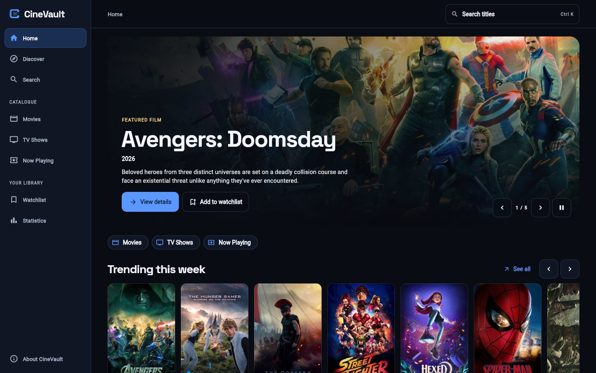

# CineVault

CineVault brings cinema discovery, an interconnected movie and TV catalogue, and a personal viewing library to a single Flutter app. It uses a blue-and-gold interface with responsive desktop, tablet, and phone navigation.

[Desktop catalogue](docs/screenshots/phase2/after-home-1440.jpg) · [Movie and TV exploration](docs/screenshots/phase3/web-mobile-gallery.jpg) · [Personal library on Android](docs/screenshots/phase4/android-overview.jpg)



## What you can do

- Explore curated movie and TV shelves, theatrical releases, and filtered catalogue results. Search for titles, people, collections, companies, and keywords, or look up a supported external ID.
- Follow links among titles, full credits, person profiles, sortable filmographies, collections, studios, networks, genres, and keywords. Explore TV seasons, specials, episodes, stills, and guest stars.
- Find release information, reviews, trailers, galleries, and regional streaming, rental, and purchase availability. Provider and trailer links open their original destinations.
- Save movies and shows, keep custom lists, favorite titles and people, and revisit recent discoveries. Log repeat viewings with a rating, review, notes, and a date. Track watched episodes and see the next known unwatched episode.
- Get explainable recommendations and upcoming picks from your library and TMDB relationships. Review viewing time, activity, genres, languages, countries, favorite people, and milestones.
- Keep the personal library locally in Hive. Export a JSON backup or a CSV, or merge a backup into an existing library. On Web, a previously loaded app shell is needed for offline access when the site itself is unavailable.

## Run locally

Use Flutter 3.50.1 with Dart 3.14.0 to reproduce the verified builds. Install the platform toolchain listed by `flutter doctor -v`.

```sh
git clone https://github.com/nascent-sky/CineVault.git
cd CineVault
git switch feature/ui-redesign
flutter pub get
```

Copy [.env.example](.env.example) to `.env` and replace the placeholder with your own TMDB v3 API key. Start the app with that file explicitly. [TMDB registration and authentication](https://developer.themoviedb.org/docs/authentication-application)

```sh
flutter run -d chrome --dart-define-from-file=.env
flutter run -d windows --dart-define-from-file=.env
flutter run -d <android-device-id> --dart-define-from-file=.env
```

Use `flutter devices` to find a target. The build has no configured key by default; the app explains that live catalogue access needs configuration, and the local library remains available. `.env` is ignored by Git and excluded from Flutter assets. Passing `--dart-define-from-file=.env` makes the key extractable from that local build. Keep key-bearing builds private. A public build with managed live credentials needs an approved distribution design.

## Build and verify

```sh
flutter analyze
flutter test
flutter build web --release --no-web-resources-cdn
flutter build apk --release
flutter build windows --release
```

The default Android APK uses debug signing for local QA. Supply an ignored `android/key.properties` with `storeFile`, `storePassword`, `keyAlias`, and `keyPassword` for production signing. Resolve a relative `storeFile` from `android/`. Set `CINEVAULT_REQUIRE_RELEASE_SIGNING=true` in the build environment to fail if production signing credentials are missing. Keep signing files outside version control.

| Platform | Verification |
| --- | --- |
| Web | Chrome release builds, responsive layouts, typed links and browser history, Hive persistence, and backup round-trips. Hardware performance measured on Intel UHD. |
| Android | Release APK, host-accelerated Pixel 9 emulator, live catalogue and personal library checks. |
| Windows | x64 release build and native runtime with live catalogue, accessibility inspection, and native JSON picker round-trip. |
| iOS, macOS, Linux | Flutter targets are maintained in the project. See the release matrix for outstanding build and runtime checks. |

## Architecture

| Area | Responsibility |
| --- | --- |
| [`lib/app`](lib/app) | Responsive shell integration, typed routes, browser history, and bounded mounted exploration state. |
| [`lib/catalogue`](lib/catalogue) and [`lib/core/network`](lib/core/network) | TMDB repositories, deduplicated requests, bounded JSON caches, paginated feeds, and CDN artwork selection. |
| [`lib/library`](lib/library) | Backward-compatible Hive storage, diary and tracking records, JSON and CSV serialization, and personal discovery and statistics. |
| [`lib/ui`](lib/ui) | Shared artwork, poster grids, design tokens, entity views, and offline personal library screens. |
| [`test`](test) and [`scripts`](scripts) | Deterministic fixtures, Flutter regression tests, hardware Chrome and native checks, and credential-redacted measurements. |

On hardware-accelerated Chrome, fresh title metadata improved from 169.3 to 133.1 ms at p95. The median share of animation callbacks over 16.7 ms during sustained scrolling fell from 3.36% to 2.72%. Cold Home p95 increased from 621.9 to 712.3 ms on the same test host. [Phase 5 results and reproduction](docs/PHASE5_RESULTS.md)

[Upgrade roadmap](docs/UPGRADE_PLAN.md) · [Pull request summary for reviewers](docs/PULL_REQUEST_SUMMARY.md)

## Credits

Developed by **Sudheer Prajapati**. [Original author on GitHub](https://github.com/Sudheer21052005)

This product uses the TMDB API but is not endorsed or certified by TMDB. Catalogue data and imagery come from [The Movie Database](https://www.themoviedb.org/). Regional viewing availability is supplied by JustWatch via TMDB.

[Manrope font license](assets/fonts/Manrope-OFL.txt) · [Space Grotesk font license](assets/fonts/SpaceGrotesk-OFL.txt) · [TMDB logo and attribution guidelines](https://www.themoviedb.org/about/logos-attribution)
